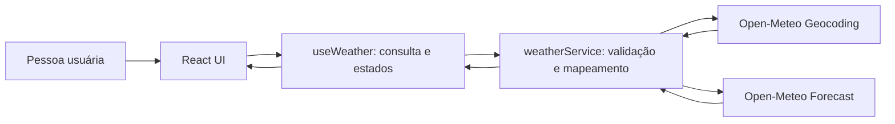

# Plano Técnico — Weather App

**Entrada:** [Especificação do produto](../specs/weather-app-spec.md)
**Status:** plano inicial; decisões de produto pendentes estão listadas em [Open Decisions](#open-decisions).

## Architecture Overview

Aplicação cliente React, organizada em componentes de apresentação, um hook de orquestração e um serviço responsável por chamadas HTTP e adaptação das respostas externas para modelos de domínio. Sem backend próprio, autenticação ou persistência de servidor no escopo atual.



Responsabilidades:

- **UI:** coleta a busca, permite escolher uma cidade e apresenta clima atual, resumo diário, detalhes por hora, unidade e estados da consulta.
- **Hook:** coordena busca, seleção, consulta, retry e status; evita que respostas de uma busca anterior substituam o resultado da seleção atual.
- **Serviço:** faz as requisições, trata timeout/status HTTP, valida os dados mínimos e converte o formato da API para os tipos internos.
- **Utilitários de domínio/apresentação:** conversão de temperatura, formatação de datas/horas e tradução de códigos meteorológicos.

## Tech Stack

| Camada | Tecnologia | Uso |
| --- | --- | --- |
| Aplicação | React 19 + TypeScript 6 | SPA tipada e componentes funcionais. |
| Desenvolvimento/build | Vite 8 | Servidor local e build estático. |
| Estilos | Tailwind CSS 3.4 | Layout responsivo e estilos existentes. |
| Estado | React `useState` e hook `useWeather` | Estado local da busca e consulta; sem biblioteca global nesta escala. |
| Dados externos | Open-Meteo Geocoding + Forecast | Geocodificação e clima sem chave de API, selecionada conforme a stack do projeto. |
| Testes unitários/componentes | Vitest + Testing Library + jsdom | Serviço, mapeadores, utilitários, hook e interações da UI. |
| Testes de navegador | Playwright | Fluxos completos, estados e viewport móvel. |
| Qualidade | Biome | Lint e formatação conforme configuração do repositório. |

Não adicionar gerenciador de estado ou biblioteca de cache até existir necessidade demonstrada de estado compartilhado, persistência ou revalidação em múltiplas telas.

## Project Structure

Preservar os diretórios atuais e ampliar os componentes e modelos existentes, sem criar camadas paralelas:

```text
src/
  App.tsx                         # composição da página e estado da unidade
  components/
    SearchBar.tsx                 # entrada e envio da busca
    CurrentWeather.tsx            # clima atual
    ForecastList.tsx              # previsão diária
    ForecastCard.tsx              # resumo de um dia
    ForecastHourlyList.tsx        # novo: detalhes horários do dia selecionado
    UnitToggle.tsx                # alternância C/F
    states/
      EmptyState.tsx              # busca sem resultados
      ErrorState.tsx              # falha e ação de retry
      LoadingState.tsx            # feedback de carregamento
  hooks/
    useWeather.ts                 # estado e orquestração da busca/consulta
  services/
    weatherService.ts             # chamadas Open-Meteo e mapeamento para domínio
  lib/
    format.ts                     # datas, horários e valores apresentados
    temperature.ts                # conversão C/F
    weatherCodes.ts               # descrição/ícone por código meteorológico
  types/
    weather.ts                    # City, CurrentWeather, ForecastDay, ForecastHour, WeatherData
  styles/
    index.css                     # estilos globais e diretivas Tailwind

tests/
  unit/                           # testes de serviço, domínio, hook e componentes
  e2e/                            # fluxos integrados com APIs interceptadas
```

`ForecastHourlyList.tsx` exibe os detalhes horários do dia selecionado. Na v1, cada resumo diário tem um botão que expande um único dia por vez; o botão expõe `aria-expanded` e funciona por teclado. O painel aparece após a grade para preservar o alinhamento dos cards.

## Data Model

Definir modelos internos independentes do formato Open-Meteo. Temperaturas são mantidas em Celsius no domínio e convertidas apenas na apresentação, para que alternar unidade não gere nova requisição.

```ts
export type Unit = 'celsius' | 'fahrenheit';

export interface City {
  id: number;
  name: string;
  country: string;
  admin1?: string;
  latitude: number;
  longitude: number;
}

export interface CurrentWeather {
  time: string;
  temperature: number;
  weatherCode: number;
  humidity: number | null;
  windSpeed: number | null;
  pressure: number | null;
  precipitation: number | null;
}

export interface ForecastDay {
  date: string;
  min: number;
  max: number;
  weatherCode: number;
  precipitationProbability: number | null;
}

export interface ForecastHour {
  time: string;
  temperature: number;
  weatherCode: number;
  precipitationProbability: number | null;
  precipitation: number | null;
  windSpeed: number | null;
  humidity: number | null;
}

export interface WeatherData {
  city: City;
  current: CurrentWeather;
  forecast: ForecastDay[];
  hourlyForecast: ForecastHour[];
}
```

Notas de contrato:

- `time` deve permanecer no formato ISO retornado pela API e ser interpretado com o fuso retornado/configurado; evitar tratar horário local como UTC implicitamente.
- Campos que podem faltar na resposta ou no plano da API são anuláveis/ausentes e devem ser tratados pela apresentação, sem substituir dado ausente por zero quando zero tiver significado meteorológico.
- `forecast` precisa conter exatamente cinco datas locais válidas e consecutivas, começando pela data de `current.time`. O mapeador deve preservar a ordem recebida e associar horas à data local correta.
- `precipitationProbability` diária e horária deve preservar `null` como indisponível, em vez de convertê-lo automaticamente para `0`.

## Data Flow

1. A pessoa digita um termo e envia a busca. Entrada vazia ou composta por espaços não gera request.
2. `useWeather.search(query)` define `loading`, limpa erros/resultados incompatíveis com a nova busca e chama `searchCities`.
3. `weatherService.searchCities` codifica a query e consulta a API de geocoding. A resposta é mapeada para `City[]`.
4. A UI apresenta os resultados com cidade e contexto geográfico disponível (estado/região e país). A pessoa escolhe uma cidade; não selecionar automaticamente o primeiro resultado quando isso puder ocultar uma ambiguidade.
5. `useWeather.selectCity(city)` consulta `getWeather(city)` e mantém a cidade selecionada associada ao resultado.
6. O serviço consulta dados atuais, diários e horários; valida a resposta e mapeia para `WeatherData`.
7. O hook publica `success` e os dados. A UI mostra clima atual, cinco dias e os dados por hora agrupados/filtrados para o dia consultado.
8. `UnitToggle` altera somente estado de apresentação; `temperature.ts` converte todos os valores de temperatura sem novo request.
9. Em falha, o hook publica `error` e expõe `retry`; em consulta sem correspondências, publica `empty`.

Para impedir resultados obsoletos, associar cada busca/seleção a um `AbortController` ou identificador de requisição e ignorar respostas que não correspondam à seleção vigente.

## External APIs

### Open-Meteo Geocoding

- **Endpoint:** `GET https://geocoding-api.open-meteo.com/v1/search`
- **Parâmetros:** `name` (texto codificado), `count` (limite de resultados), `language=pt` e `format=json`; a interface usa pt-BR.
- **Mapeamento:** `id`, `name`, `country`, `admin1`, `latitude`, `longitude` para `City`.
- **Sem resultados:** resposta sem `results` ou com lista vazia é estado vazio, não erro de transporte.

### Open-Meteo Forecast

- **Endpoint:** `GET https://api.open-meteo.com/v1/forecast`
- **Parâmetros base:** `latitude`, `longitude`, `timezone=auto` e `forecast_days=5`; a janela inclui hoje e os quatro dias locais seguintes.
- **Campos atuais:** `current=temperature_2m,relative_humidity_2m,wind_speed_10m,surface_pressure,precipitation,weather_code`.
- **Campos diários:** `daily=weather_code,temperature_2m_max,temperature_2m_min,precipitation_probability_max`.
- **Campos horários propostos:** `hourly=time,temperature_2m,relative_humidity_2m,precipitation_probability,precipitation,wind_speed_10m,weather_code`.
- **Unidades:** solicitar/manter temperaturas em Celsius no contrato interno. Demais unidades e rótulos devem ser definidos para não apresentar valores sem unidade.
- **Localização:** unidade inicial Celsius; interface pt-BR; geocoding solicita `language=pt`.
- **Validação:** conferir limites e termos de uso antes da produção. Não assumir SLA ou disponibilidade garantida.

Uma falha na previsão não deve apagar resultados de geocoding úteis. Como o clima atual, diário e horário vêm do mesmo serviço de forecast, validar os dados essenciais e permitir degradar uma seção se uma série não essencial estiver ausente; se não houver dados suficientes para exibir a previsão solicitada, apresentar erro recuperável.

## State Management

Manter estado local por meio do `useWeather` já existente, com estados explícitos:

A unidade inicial é Celsius; textos e formatação usam pt-BR. Celsius e Fahrenheit continuam disponíveis para alternância.

```ts
type WeatherStatus = 'idle' | 'loading' | 'results' | 'success' | 'error' | 'empty';
```

O hook mantém `query`, `cities`, `selectedCity` (ou deriva da cidade em `data`), `data`, `status`, `error` e a ação `retry`. A unidade (`Unit`) vive na camada de apresentação (`App` ou `UnitToggle` controlado). Não persistir cidade/unidade entre visitas enquanto a persistência continuar aberta na spec. Não copiar valores convertidos para o estado: derivá-los ao renderizar.

Ao iniciar uma busca diferente, limpar estado de erro e resultados antigos que possam ser confundidos com a nova query. Ao selecionar uma cidade, manter o vínculo explícito entre cidade e dados exibidos. `retry` deve repetir a última ação que falhou (busca de cidades ou previsão da cidade selecionada).

## Error Handling Strategy

- **Loading:** exibir feedback para busca e previsão; manter o layout utilizável e controles essenciais acessíveis.
- **Empty:** query válida sem resultados exibe mensagem de ausência; input vazio orienta a pessoa sem request.
- **Network/timeout:** usar timeout cancelável com `AbortController`, classificar falha de rede/timeout e oferecer retry.
- **HTTP error:** converter resposta não-OK para erro de serviço com mensagem compreensível; não expor detalhes técnicos da API.
- **Payload inválido/incompleto:** validar campos indispensáveis antes do mapeamento; sinalizar erro recuperável se não for possível mostrar a informação pedida.
- **Dados parciais:** representar ausências como indisponíveis e manter o restante do conteúdo renderizável; não confundir dado ausente com zero.
- **Respostas fora de ordem:** cancelar ou descartar respostas de buscas/seleções anteriores.
- **Retry:** preservar a query ou cidade da operação que falhou e repetir somente a operação necessária.

Erros técnicos devem ser registrados de forma útil para diagnóstico sem incluir dados pessoais desnecessários. A API recebe nome da cidade ou coordenadas da localização escolhida para fornecer o serviço.

## Testing Strategy

### Unitários e componentes (Vitest + Testing Library)

- `weatherService`: query vazia, codificação de caracteres/acentos, mapeamento de geocoding, lista vazia, HTTP não-OK, timeout, falha de rede, payload inválido e mapeamento de dados current/daily/hourly.
- Mapeadores: alinhar arrays de `time` e variáveis horárias, manter ordem, agrupar horas por data/fuso e tratar campos `null`/ausentes sem quebrar.
- `temperature.ts`: conversões C/F e consistência entre clima atual, mín/máx e horas; alternância não chama API.
- `useWeather`: transições loading/success/empty/error, retry, seleção de cidade e resposta obsoleta ignorada.
- Componentes: seleção de resultados ambíguos por teclado, detalhes horários, estados acessíveis e dados ausentes.

### E2E (Playwright)

- Fluxo de busca, seleção explícita de cidade, clima atual, cinco dias e detalhe diário/horário usando respostas de API interceptadas.
- Estado vazio para cidade inexistente e mensagens/retry para falhas de geocoding e forecast.
- Alternância C/F atualiza todas as temperaturas sem uma nova chamada de forecast.
- Validar fluxo principal em viewport móvel e operação por teclado/roles semânticos.
- Incluir fixture com múltiplas cidades homônimas e resposta horária distribuída em mais de uma data.

### Gates locais/CI

Usar os scripts existentes: `pnpm lint`, `pnpm build`, `pnpm test` e `pnpm test:e2e`. Testes de rede devem usar mocks determinísticos; a suíte não deve depender da disponibilidade da API externa.

## Risks & Trade-offs

| Risco/decisão | Consequência | Mitigação |
| --- | --- | --- |
| Limites ou indisponibilidade da API pública | Busca ou atualização pode falhar sem controle do cliente | Mensagens/retry, timeout e monitorar limites/termos antes da publicação. Cache é decisão futura, não requisito atual. |
| Cidades homônimas | Consulta incorreta se o primeiro resultado for selecionado implicitamente | Apresentar país/região e exigir seleção quando houver ambiguidade. |
| Séries horárias e diárias usam fusos/datas diferentes | Hora pode aparecer no dia errado | Solicitar `timezone=auto`, preservar os timestamps e testar transições de data/fuso. |
| Datas locais podem divergir do relógio do dispositivo | Rótulos relativos podem não corresponder ao dia local da cidade consultada | Usar o fuso informado pela API ao associar as horas e a previsão diária. |
| Propriedades da resposta horária podem estar ausentes | Detalhes incompletos ou conversões incorretas | Tipos anuláveis, validação e tratamento de disponibilidade por campo. |
| Serviço HTTP direto do browser | Acoplamento a CORS, limites e disponibilidade do fornecedor | Isolar chamadas no serviço; migrar para proxy/backend apenas se requisito de segurança, confiabilidade ou política o exigir. |
| Novos textos ou formatos podem divergir do pt-BR | Busca e apresentação podem ficar inconsistentes | Manter textos e formatação em pt-BR e solicitar `language=pt` ao geocoding. |

## Open Decisions

Resolver ou registrar explicitamente antes de considerar o plano fechado:

1. Definir se unidade/cidade são persistidas e se haverá qualquer comportamento offline/cache.
2. Definir limite mensurável de desempenho e navegadores suportados, caso sejam requisitos de aceitação.
